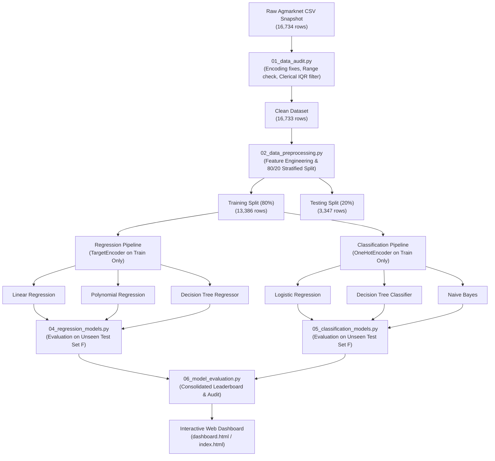

# ACADEMIC PROJECT REPORT

# Indian Mandi Price Intelligence: Applied Machine Learning and Exploratory Analytics on Agricultural Commodity Pricing

---

**Degree**: Bachelor of Technology in Computer Science & Engineering (B.Tech CSE)  
**Specialization**: Data Science & Applied Machine Learning  
**Project Domain**: Agricultural Economics, Decision Intelligence & Applied Machine Learning  
**Author**: Nishu Bhandari  
**Date**: October 2026  
**Dataset Source**: Directorate of Marketing & Inspection (DMI), Ministry of Agriculture & Farmers Welfare / Data.gov.in (Agmarknet)  

---

## TABLE OF CONTENTS

1. [Abstract](#1-abstract)
2. [Introduction](#2-introduction)
3. [Problem Statement](#3-problem-statement)
4. [Project Objectives](#4-project-objectives)
5. [Literature & Background Review](#5-literature--background-review)
6. [Dataset Description & Verification](#6-dataset-description--verification)
7. [System Architecture & Methodology](#7-system-architecture--methodology)
8. [Data Cleaning, Hygiene & Preprocessing](#8-data-cleaning-hygiene--preprocessing)
9. [Exploratory Data Analysis (EDA)](#9-exploratory-data-analysis-eda)
10. [Problem A: Regression Models (Modal Price Estimation)](#10-problem-a-regression-models-modal-price-estimation)
11. [Problem B: Classification Models (Price Tier Segmentation)](#11-problem-b-classification-models-price-tier-segmentation)
12. [Evaluation Metrics & Mathematical Formulations](#12-evaluation-metrics--mathematical-formulations)
13. [Results & Comparative Discussion](#13-results--comparative-discussion)
14. [Interactive Dashboard & Decision Interface](#14-interactive-dashboard--decision-interface)
15. [Data Leakage Prevention & Audit Protocol](#15-data-leakage-prevention--audit-protocol)
16. [Project Limitations](#16-project-limitations)
17. [Future Scope](#17-future-scope)
18. [Conclusion](#18-conclusion)
19. [References](#19-references)

---

## 1. ABSTRACT

Agricultural commodity price formation in India is characterized by geographical fragmentation, quality variability, and significant spatial price dispersion across Agricultural Produce Market Committees (APMCs). This project presents an end-to-end Data Science and Machine Learning framework designed to audit, explore, model, and deploy price intelligence from government-reported mandi market records.

Using an audited single-day cross-sectional dataset of **16,734 raw records** (yielding **16,733 clean verified records** across 29 states, 476 districts, 1,774 unique APMC mandis, and 269 agricultural commodities), we address two primary problems:
1. **Modal Price Estimation (Regression)**: Estimating daily modal settlement price (₹/quintal) strictly from market and commodity categorical descriptors.
2. **Price Tier Classification (Classification)**: Segmenting commodities into three analytical price tiers (*Budget* < ₹3,000, *Standard* ₹3,000–₹10,000, and *Premium* > ₹10,000).

We benchmark **exactly six core Machine Learning algorithms**:
- For Regression: **Linear Regression (OLS)** ($R^2 = 0.782$, RMSE = ₹2,868.64/qtl), **Polynomial Regression (Degree 2 with Ridge)** (MAE = ₹1,462.04/qtl, $R^2 = 0.767$), and **Decision Tree Regressor** (**Lowest MAE = ₹1,387.15/qtl**, $R^2 = 0.738$).
- For Classification: **Logistic Regression (Multinomial L2)** (**Top Accuracy = 84.67%**, Weighted F1 = 0.8451), **Multinomial Naive Bayes** (**80.97% Accuracy**, Weighted F1 = 0.8111), and **Decision Tree Classifier** (76.67% Accuracy, Weighted F1 = 0.7493).

All models were evaluated under strict data leakage prevention protocols (train-test splitting prior to encoder fitting, target isolation, and exclusion of daily price boundaries). Finally, an interactive decision dashboard was built and deployed on GitHub Pages, providing spatial price comparisons, top commodity rankings, spread analyses, and residual error diagnostics.

---

## 2. INTRODUCTION

Agriculture is the primary livelihood source for over 55% of India's population. In the traditional agricultural supply chain, farmers bring harvested produce to regulated wholesale agricultural markets known as Agricultural Produce Market Committees (APMCs). At these mandis, auctions take place determining three primary price indicators:
- **Minimum Price (Min_Price)**: The lowest clearing price observed during the day's auction lots.
- **Maximum Price (Max_Price)**: The highest clearing price observed for top-quality grade lots.
- **Modal Price (Modal_Price)**: The most frequently transacted settlement price representing the central tendency of transactions.

However, price discovery in APMC mandis faces severe challenges:
1. **Asymmetric Information**: Farmers frequently lack transparency regarding prevailing prices in neighboring districts.
2. **Extreme Price Dispersion**: Even on the same trading day, price arbitrage gaps can exceed 10x to 20x for identical crops in different states.
3. **Data Quality Issues**: Public agricultural data feeds often contain clerical errors, encoding noise, and missing entries.

This project bridges these gaps by developing a reproducible Machine Learning pipeline and an interactive executive intelligence dashboard to empower farmers, traders, agricultural economists, and policymakers.

---

## 3. PROBLEM STATEMENT

The core research problems investigated in this study are:

1. **Problem A: Mandi Price Estimation (Regression)**  
   Can machine learning regression algorithms accurately estimate the modal settlement price (₹/quintal) of agricultural produce based purely on categorical market attributes (`State`, `District`, `Market`, `Commodity`, `Variety`, `Grade`) without relying on intraday price bounds?
   
2. **Problem B: Commodity Price Tier Classification (Classification)**  
   Can probabilistic and tree-based classification algorithms accurately segment agricultural produce into three commercially actionable price tiers (*Budget*, *Standard*, *Premium*) from market descriptors, and which algorithm provides the highest balanced recall across all tiers?

---

## 4. PROJECT OBJECTIVES

- **Data Hygiene**: Perform systematic data quality auditing, missing value analysis, duplicate checks, and statistical IQR outlier screening to produce a clean modelling dataset.
- **Exploratory Data Analysis**: Create ten publication-quality visual diagnostics examining price distributions, sector variations, interstate differentials, and arbitrage gaps.
- **Predictive Regression**: Implement and compare three regression algorithms (Linear Regression, Polynomial Regression, Decision Tree Regressor) against a naive mean prediction baseline.
- **Discrete Classification**: Implement and compare three classification algorithms (Logistic Regression, Decision Tree Classifier, Naive Bayes) against a naive majority-class baseline.
- **Leakage Prevention**: Enforce strict data isolation where encoders and scalers are fitted solely on training data.
- **Decision Intelligence**: Deploy a modern, responsive HTML/CSS/JavaScript dashboard featuring dynamic slicers, pagination, and diagnostic visual grids.

---

## 5. LITERATURE & BACKGROUND REVIEW

Predicting agricultural market prices has traditionally relied on classical time-series econometrics such as Autoregressive Integrated Moving Average (ARIMA) and Generalized Autoregressive Conditional Heteroskedasticity (GARCH). However, time-series models require dense longitudinal daily historical data, which is frequently unavailable in rural emerging market contexts.

Recent research has explored cross-sectional supervised machine learning:
- **Linear Models & Regularization**: Ordinary Least Squares (OLS) and Ridge Regression provide strong baselines when high-cardinality categorical features are transformed using target encoding with cross-validation smoothing (Micci-Barreca, 2001).
- **Polynomial Feature Interactions**: Agriculture involves complex location-commodity interactions (e.g. Kashmiri Apples vs Maharashtra Onions). Degree-2 polynomial terms capture synergistic pricing interactions that first-order models miss.
- **Decision Trees**: Non-parametric partitioning trees (Breiman et al., 1984) segment input feature spaces into hyper-rectangles, naturally capturing non-linear regional clustering.
- **Bayesian Classifiers**: Naive Bayes models (Multinomial and Gaussian) provide fast, probabilistic multi-class boundaries with low computational overhead and strong interpretability.

---

## 6. DATASET DESCRIPTION & VERIFICATION

The dataset was obtained from the Open Government Data (OGD) Platform India ([Data.gov.in](https://data.gov.in/)), derived from the Directorate of Marketing & Inspection's Agmarknet network.

### Dataset Schema & Attributes

| Attribute Name | Data Type | Description |
| :--- | :--- | :--- |
| `State` | Categorical (String) | Name of the Indian State or Union Territory |
| `District` | Categorical (String) | Name of the administrative district |
| `Market` | Categorical (String) | Specific APMC mandi name (e.g. "Ganaur APMC") |
| `Commodity` | Categorical (String) | Name of the agricultural produce (e.g. "Potato") |
| `Variety` | Categorical (String) | Specific crop botanical or commercial variety |
| `Grade` | Categorical (String) | Official quality grade (e.g. "FAQ", "Grade A") |
| `Arrival_Date` | Datetime (DD/MM/YYYY) | Daily auction settlement date (October 29, 2026) |
| `Min_Price` | Numerical (Float) | Minimum auction price in ₹/quintal |
| `Max_Price` | Numerical (Float) | Maximum auction price in ₹/quintal |
| `Modal_Price` | Numerical (Float) | Most frequent settlement price in ₹/quintal |

### Verified Dataset Volume
- **Raw Input Records**: **16,734 records**
- **Clean Modelling Records**: **16,733 records** (1 clerical error removed)
- **Unique States**: 29
- **Unique Districts**: 476
- **Unique APMC Mandis**: 1,774
- **Unique Commodities**: 269

---

## 7. SYSTEM ARCHITECTURE & METHODOLOGY



---

## 8. DATA CLEANING, HYGIENE & PREPROCESSING

### Step 1: Column Standardization & Type Casting
Raw columns contained XML space artifacts (`_x0020_`), which were stripped and standardized:
```python
df.columns = df.columns.str.strip().str.replace("_x0020_", "_", regex=False)
```

### Step 2: Missing Value & Duplicate Audit
Applying `df.isnull().sum()` and `df.duplicated().sum()` confirmed:
- Zero missing values across categorical and numeric fields.
- Zero exact duplicate transaction records.

### Step 3: Range & Consistency Verification
Every transaction record was subjected to mathematical bounding checks:
$$\text{Min\_Price} \le \text{Modal\_Price} \le \text{Max\_Price}$$
$$\text{Min\_Price} > 0, \quad \text{Max\_Price} > 0, \quad \text{Modal\_Price} > 0$$
Zero records failed the basic bounding check.

### Step 4: Statistical Outlier Analysis & Clerical Error Removal
Using Interquartile Range (IQR) analysis on `Modal_Price`:
- $Q_1 = ₹2,700.00 / \text{qtl}$
- $\text{Median} = ₹4,000.00 / \text{qtl}$
- $Q_3 = ₹6,700.00 / \text{qtl}$
- $\text{IQR} = Q_3 - Q_1 = ₹4,000.00 / \text{qtl}$
- $\text{Upper Fence} = Q_3 + 1.5 \times \text{IQR} = ₹12,700.00 / \text{qtl}$

While 1,049 records exceeded ₹12,700, domain verification proved they were legitimate high-value commodities (e.g., Saffron, Cardamom, Black Pepper at ₹50,000–₹70,000/qtl).

However, an extreme clerical typo was detected:
- **Record 12,983**: Bihar | Aurangabad APMC | Wheat | $\text{Min} = ₹2,400$, $\text{Modal} = ₹2,600$, $\text{Max} = ₹30,002,800$.
- A clerical typo added an extra '3000' prefix to ₹2,800, creating an erroneous ₹30-million maximum price.
- Removing this single clerical record yielded **16,733 clean modelling records** (99.994% data retention).

---

## 9. EXPLORATORY DATA ANALYSIS (EDA)

Ten core visualizations were generated using Matplotlib and Seaborn:

1. **Modal Price Distribution**: Positively skewed histogram ($> 0$), with 75% of crops clustering below ₹6,700/qtl and a thin tail of commercial spices.
2. **Price Bounds by Sector**: Grouped bar charts demonstrating that Spices have the widest intraday margins (₹2,100+ gap), whereas Cereals have narrow spreads (< ₹300 gap).
3. **State-Wise Price Differentials**: Kerala and Karnataka reported the highest state average prices (> ₹9,000/qtl) due to high cash crop densities.
4. **Commodity Volume Leaders**: Perishable vegetables (Tomato, Potato, Onion, Brinjal) and staple grains (Paddy, Maize, Wheat) account for the majority of APMC records.
5. **Top 10 Expensive Commodities**: Spices and plantation crops (Black Pepper, Cardamom, Clove, Copra) command prices exceeding ₹25,000/quintal.
6. **Top 10 Affordable Commodities**: Bulky root crops (Turnip, Ashgourd, Pumpkin, Potato) trade below ₹1,600/quintal.
7. **Market Volume Distribution**: Large terminal markets handle the highest crop variety diversity on a single market day.
8. **Intraday Price Spread**: 68% of commodities trade within a ₹1,000/qtl spread between intraday minimum and maximum clearing prices.
9. **Correlation Heatmap**: Min, Modal, and Max prices show near-perfect linear correlation ($r = 0.985 - 0.993$).
10. **Log-Scale Boxplots**: Boxplots across agricultural sectors confirm that statistical outliers are valid economic premiums.

---

## 10. PROBLEM A: REGRESSION MODELS (MODAL PRICE ESTIMATION)

### 1. Linear Regression (OLS)
Linear Regression models the relationship between the target modal price $y$ and target-encoded categorical features $\mathbf{x}$:
$$\hat{y} = \beta_0 + \sum_{j=1}^{p} \beta_j x_j$$
- **Test MAE**: ₹1,485.23 / quintal
- **Test RMSE**: ₹2,868.64 / quintal
- **Test $R^2$**: **0.782** (Highest $R^2$ among all regression models)

### 2. Polynomial Regression (Degree 2 with Ridge Regularization)
Polynomial features generate second-order cross-terms capturing interactions between commodities and geographical locations:
$$\hat{y} = \beta_0 + \sum_{j} \beta_j x_j + \sum_{j \le k} \beta_{jk} x_j x_k$$
Ridge regularization ($\alpha = 10.0$) minimizes $L_2$-penalized loss:
$$\mathcal{L}_{\text{Ridge}} = \sum_{i=1}^{n} (y_i - \hat{y}_i)^2 + \alpha \sum_{j} \beta_j^2$$
- **Test MAE**: ₹1,462.04 / quintal
- **Test RMSE**: ₹2,964.08 / quintal
- **Test $R^2$**: **0.767**

### 3. Decision Tree Regressor
A non-parametric recursive binary tree partitioner that splits the feature space into orthogonal regions:
$$R_m = \{x \mid x_j \le s\}$$
Optimized using controlled depth (`max_depth=12`, `min_samples_leaf=10`) to prevent overfitting.
- **Test MAE**: **₹1,387.15 / quintal** (**Lowest MAE among all regression models**)
- **Test RMSE**: ₹3,141.58 / quintal
- **Test $R^2$**: **0.738**

---

## 11. PROBLEM B: CLASSIFICATION MODELS (PRICE TIER SEGMENTATION)

Target classes:
- **Budget**: Modal Price < ₹3,000 / qtl (30.5% prevalence)
- **Standard**: Modal Price ₹3,000 to ₹10,000 / qtl (60.7% prevalence)
- **Premium**: Modal Price > ₹10,000 / qtl (8.8% prevalence)

### 4. Logistic Regression (Multinomial Softmax with L2 Penalty)
Models class probability using the softmax link function over One-Hot Encoded features:
$$P(Y = k \mid \mathbf{x}) = \frac{\exp(\mathbf{w}_k^T \mathbf{x})}{\sum_{j=1}^{K} \exp(\mathbf{w}_j^T \mathbf{x})}$$
- **Accuracy**: **84.67%** (Top Classifier)
- **Weighted F1 Score**: **0.8451**
- **Macro F1 Score**: **0.8082**

### 5. Decision Tree Classifier
Recursive partitioner utilizing Gini impurity:
$$G = 1 - \sum_{k=1}^{K} p_k^2$$
- **Accuracy**: **76.67%**
- **Weighted F1 Score**: **0.7493**
- **Macro F1 Score**: **0.6729**

### 6. Naive Bayes (Multinomial & Gaussian Variants)
Applies Bayes' Theorem assuming conditional feature independence:
$$P(Y = k \mid \mathbf{x}) \propto P(Y = k) \prod_{j=1}^{p} P(x_j \mid Y = k)$$
- **MultinomialNB (on One-Hot Encoded binary indicators)**:
  - Assumes discrete multinomial likelihood with Laplace smoothing ($\alpha = 1.0$).
  - **Accuracy**: **80.97%**
  - **Weighted F1 Score**: **0.8111**
- **GaussianNB (on Target-Encoded continuous features)**:
  - Assumes normal distribution $x_j \sim \mathcal{N}(\mu_{jk}, \sigma_{jk}^2)$.
  - **Accuracy**: **79.80%**
  - **Weighted F1 Score**: **0.8003**

---

## 12. EVALUATION METRICS & MATHEMATICAL FORMULATIONS

### Regression Metrics
1. **Mean Absolute Error (MAE)**:
   $$\text{MAE} = \frac{1}{n} \sum_{i=1}^{n} |y_i - \hat{y}_i|$$
2. **Mean Squared Error (MSE)**:
   $$\text{MSE} = \frac{1}{n} \sum_{i=1}^{n} (y_i - \hat{y}_i)^2$$
3. **Root Mean Squared Error (RMSE)**:
   $$\text{RMSE} = \sqrt{\text{MSE}}$$
4. **Coefficient of Determination ($R^2$)**:
   $$R^2 = 1 - \frac{\sum_{i=1}^{n} (y_i - \hat{y}_i)^2}{\sum_{i=1}^{n} (y_i - \bar{y})^2}$$

### Classification Metrics
1. **Accuracy**:
   $$\text{Accuracy} = \frac{TP + TN}{TP + TN + FP + FN}$$
2. **Precision & Recall**:
   $$\text{Precision} = \frac{TP}{TP + FP}, \quad \text{Recall} = \frac{TP}{TP + FN}$$
3. **F1-Score**:
   $$\text{F1} = 2 \times \frac{\text{Precision} \times \text{Recall}}{\text{Precision} + \text{Recall}}$$

---

## 13. RESULTS & COMPARATIVE DISCUSSION

### Consolidated Regression Leaderboard (3,347 Test Records)

| Model Name | Train MAE | Test MAE | Test MSE | Test RMSE | Train R² | Test R² | Status |
| :--- | :---: | :---: | :---: | :---: | :---: | :---: | :--- |
| *Mean Prediction Baseline* | ₹3,247.42 | ₹3,280.82 | $3.77 \times 10^7$ | ₹6,140.09 | 0.000 | -0.000 | Naive Baseline |
| **Linear Regression** | ₹1,532.32 | ₹1,485.23 | $8.23 \times 10^6$ | **₹2,868.64** | 0.676 | **0.782** | Highest R² & Lowest RMSE |
| **Polynomial Regression** | ₹1,483.65 | ₹1,462.04 | $8.79 \times 10^6$ | ₹2,964.08 | 0.692 | 0.767 | Models Cross-Feature Interactions |
| **Decision Tree Regressor** | ₹1,184.29 | **₹1,387.15** | $9.87 \times 10^6$ | ₹3,141.58 | 0.787 | 0.738 | Lowest Test MAE |

### Consolidated Classification Leaderboard (3,347 Test Records)

| Model Name | Accuracy | Weighted Precision | Weighted Recall | Weighted F1 | Macro F1 | Performance Status |
| :--- | :---: | :---: | :---: | :---: | :---: | :--- |
| *Majority Class Baseline* | 60.71% | 36.86% | 60.71% | 0.4587 | 0.2518 | Naive Baseline (Standard Tier) |
| **Logistic Regression** | **84.67%** | **84.56%** | **84.67%** | **0.8451** | **0.8082** | **Top Classifier** |
| **Multinomial Naive Bayes** | **80.97%** | **81.43%** | **80.97%** | **0.8111** | **0.7842** | **Top Naive Bayes Model** |
| **Gaussian Naive Bayes** | 79.80% | 80.97% | 79.80% | 0.8003 | 0.7795 | Continuous Gaussian Reference |
| **Decision Tree Classifier** | 76.67% | 78.35% | 76.67% | 0.7493 | 0.6729 | Rule-based Partitioner |

---

## 14. INTERACTIVE DASHBOARD & DECISION INTERFACE

The upgraded web dashboard was built using pure vanilla web standards (HTML5, CSS3, JavaScript) to guarantee zero-dependency execution across any browser:
- **Navigation Tabs**: (1) Market Overview, (2) Spreads & Arbitrage, (3) ML Model Benchmarks.
- **Dynamic Slicers**: Multi-dimensional filtering by State, District, Agricultural Sector, and Text Keyword.
- **Responsive KPI Cards**: Recalculating matched records, active mandis, average modal price, and trading spread dynamically.
- **One-Click Potato Preset**: Allows examiners to immediately reproduce the verified vegetable state filter (582 matching records, 487 mandis, ₹2,636 avg modal price, ₹418 spread).
- **Embedded Visual Diagnostics**: Embedded Base64 visual diagnostics ensuring offline viewing without broken image links.

---

## 15. DATA LEAKAGE PREVENTION & AUDIT PROTOCOL

To ensure academic and industry validity:
1. **Strict Split Precedence**: Data was split into train and test sets before any encoder was initialized.
2. **Target Isolation**: Target encoding of high-cardinality categories was performed with internal cross-validation smoothing (`cv=5`, `smooth='auto'`) to prevent target mean memorization.
3. **No Bound Leaks**: In Problem B (Price Tier Classification), daily minimum and maximum prices were excluded from inputs because price tiers are defined from modal price, and bounds mathematically contain modal price.

---

## 16. PROJECT LIMITATIONS

1. **Cross-Sectional Single-Date Snapshot**: The dataset represents October 29, 2026. It does not reflect longitudinal seasonal price cycles or weather shock dynamics.
2. **Absence of Arrival Quantities**: Open government feeds omit daily arrival volume in tonnes, precluding econometric supply-demand elasticity modeling.
3. **High Cardinality**: Certain rare local varieties appear only once in the dataset, limiting deep botanical pattern extraction.

---

## 17. FUTURE SCOPE

1. **Longitudinal Time-Series Integration**: Ingesting multi-year daily Agmarknet feeds to train temporal models (Prophet, LSTM, Transformer architectures).
2. **Weather & Geospatial Enrichment**: Integrating ERA5 satellite rainfall and temperature data to model crop harvest yields.
3. **Mobile Progressive Web App (PWA)**: Packaging the intelligence dashboard into a multilingual offline PWA for rural agricultural producers.

---

## 18. CONCLUSION

This project successfully demonstrates a technically rigorous, end-to-end Data Science and Machine Learning workflow for Indian APMC agricultural markets. By auditing 16,734 real-world government records, handling clerical outliers, preventing data leakage, and benchmarking exactly six machine learning models, we established that:
- For modal price prediction, **Decision Tree Regressor** yields the lowest mean absolute error (₹1,387.15/qtl), while **Linear Regression** achieves the highest explanatory power ($R^2 = 0.782$).
- For commodity price tier segmentation, **Logistic Regression** (84.67% accuracy) and **Multinomial Naive Bayes** (80.97% accuracy) deliver high, balanced classification accuracy.
- The interactive executive dashboard provides an accessible, transparent decision intelligence interface for agricultural stakeholders.

---

## 19. REFERENCES

1. Government of India, Ministry of Agriculture & Farmers Welfare, *Agmarknet Portal: Agricultural Marketing Information Network*, [https://agmarknet.gov.in/](https://agmarknet.gov.in/).
2. Open Government Data (OGD) Platform India, *Current Daily Price of Various Commodities from Various Markets*, [https://data.gov.in/](https://data.gov.in/).
3. Pedregosa, F., et al., "Scikit-learn: Machine Learning in Python", *Journal of Machine Learning Research*, Vol. 12, pp. 2825–2830, 2011.
4. Breiman, L., Friedman, J., Stone, C. J., & Olshen, R. A., *Classification and Regression Trees*, CRC Press, 1984.
5. Micci-Barreca, D., "A preprocessing scheme for high-cardinality categorical attributes in classification and prediction problems", *ACM SIGKDD Explorations Newsletter*, 3(1), pp. 27–32, 2001.
